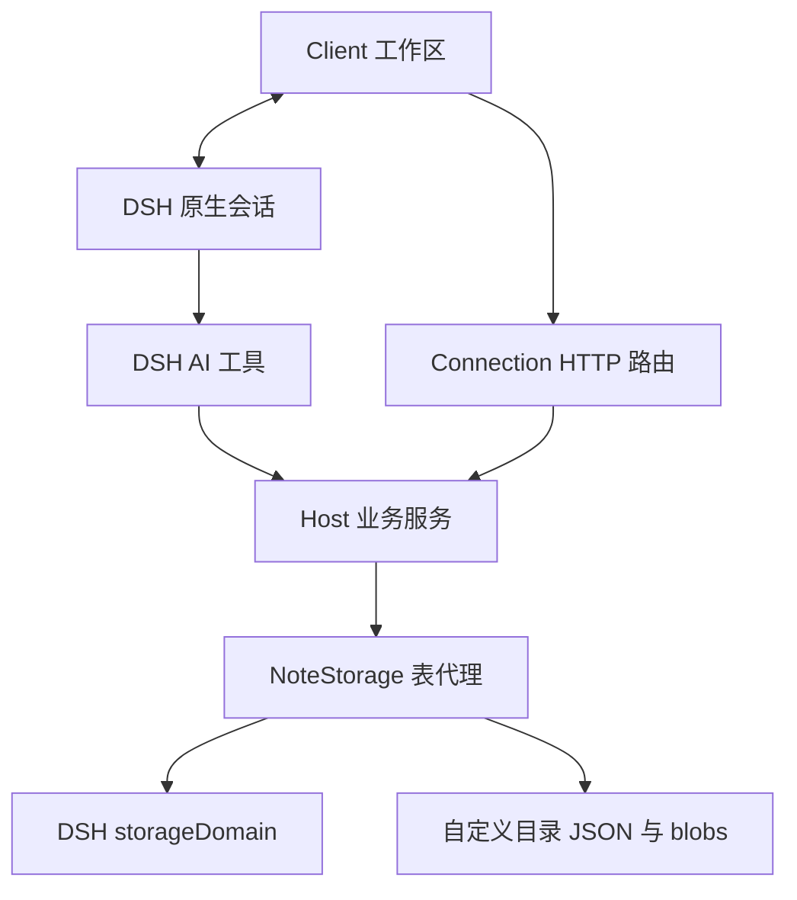

# 架构与模块规格

## 运行边界

本包是 DSH 插件。Host 运行于 Node.js 22+，Client 由 DSH Web GUI 加载。DSH 兼容版本由 [包清单](../../package.json) 的 `engines.dsh` 声明，当前为 `0.2.2-rc.1`。

Client 从宿主模块工厂 `require('react')` 获取 React；不打包第二份 React，不启动独立服务器。Host 使用宿主的 `storageDomain`、`connection`、`tools` 和 `attachments` 服务；会话共写通过可选注入的 `sessionController`、`agents`、`systemPrompt` 启用。HTTP 注册到宿主 Connection 路由，认证由宿主管理。

## 源码目录与职责

| 目录/入口 | 职责 |
| --- | --- |
| [Host 入口](../../src/host/index.js) | 服务装配、依赖注入、路由/工具注册及释放 |
| [域定义](../../src/host/domain-spec.js) | 仅装配 `dsh_note` 数据契约与迁移凭据，不加载业务或文件系统实现 |
| `src/host/*/schema.js`、`topics/references.js` | 各业务的数据/请求校验与引用协议；Store、域注册和其他业务同向依赖 |
| `src/host/notes/` | 笔记操作、历史、revision 校验、字面编辑和 HTTP/工具适配 |
| `src/host/categories/`、`src/client/categories/` | 分类树/CAS/存储接口与管理、拖放、导航和选择器 |
| `src/host/search/` | 稳定快照、派生词法视图、来源引用与分块读取 |
| `src/host/storage/` | 统一表代理、默认/目录切换及进程锁 |
| `src/host/attachments/` | 附件元信息、二进制存储、上传和下载 |
| `src/host/coauthor/` | 笔记与原生 Session 绑定及模型指令 |
| [Client 入口](../../src/client/index.js) | 宿主模块工厂、显式组件装配、侧边栏和主页面插槽 |
| `src/client/notes/` | 请求服务、工作区 `ui.js`、编辑器 `editor.js`、历史 `history.js`、草稿协调与导航 |
| `src/client/notes/draft-record.js`、`legacy-draft-cache.js`、`browser-draft-cache.js` | 纯字段/草稿协议、兼容缓存与浏览器持久化；缓存不反向依赖编辑会话 |
| `src/client/editor/`、`navigation/` | CodeMirror 原文桥接、命令/补全、虚拟分类文件树 |
| `src/client/controls/`、`markdown/` | 公共控件/命令面板、Worker 安全渲染、虚拟预览与标题树 |
| `src/client/coauthor/`、`attachments/`、`storage/`、`studio/` | 共写、附件、存储设置和笔记库展示 |
| `src/client/styles/`、`labels/` | 显式导入的 CSS 与中英文文案 |
| `scripts/build/`、`tests/`、`docs/spec/` | 构建、验证和规格 |

根目录 `index.js`、`client.js` 是 npm 预构建产物。修改源码后必须构建，禁止直接维护产物逻辑。

## 依赖方向

1. Client 入口调用 `createX(dependencies)` 工厂装配组件，宿主能力、React、翻译和请求函数均显式传入。
2. UI 只通过 HTTP 与 Host 交互，不导入 Host 文件、Node 内置模块或持久化实现。
3. Host 注册适配器调用业务服务；HTTP 与工具共用业务规则。工具正文窗口是接入层的有意差异。
4. `NotesStore` 使用表接口，`ContextSearch` 使用 `NotesStore` 的内部检索快照/读取接口；业务不直接获取宿主全局表。
5. `NoteStorage` 拥有实际持久化路由，迁移不要求业务服务重建。
6. 构建图必须只含各端自身源码与 npm 依赖，不包含测试、构建脚本或另一端源码。Client 和内嵌 Worker 都验证边界，禁止自带 React；Host 只允许 Zod 和 Node 内置外部依赖。
7. 本仓库源码的静态依赖图不得成环；`src/` 文件必须可由 Host、Client 或 Worker 入口到达。自动测试检查源图，发布检查复核正式构建图。
8. 跨模块只需数据契约时导入 `schema.js` 或引用协议，不导入具体 Store。原 Store 对既有 schema 导出的转发保留给已有调用方，新代码使用契约入口。

## 生命周期与并发

Host 启用时打开独立域，若存在 `pending` 旧版拆分迁移凭据则拒绝启动。随后启动存储并装配服务。卸载时等待附件、会话、检索、笔记、分类与存储队列完成，再关闭存储域。

Client 注册的 locale、slot、监听器、请求 AbortController、Worker、编辑器和会话引用由各模块负责释放。组件卸载会暂停编辑器、解绑缓存订阅并尝试排空已接受的编辑；未保存草稿仍可恢复。Worker 请求按 consumer 分流，卸载取消所属队列；浏览器缓存异步关闭与事务结果不得更新已退休会话。

写入队列与 revision 检查保护同一 `NotesStore` 实例；存储切换和底层表写入共享 `NoteStorage` 队列。自定义目录另有进程锁。默认存储的内存快照不提供跨实例持久 CAS：部署必须保持同一资料库只有一个有效写入实例，不能把这套实现作为多进程数据库使用。宿主是否进一步强制域独占不属于本仓库已验证能力。
